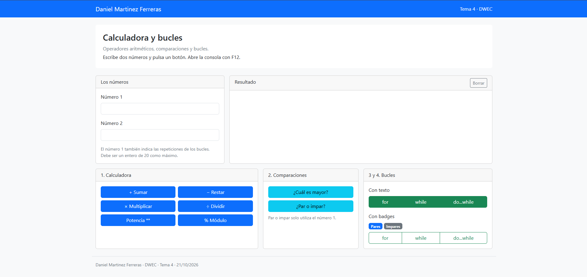
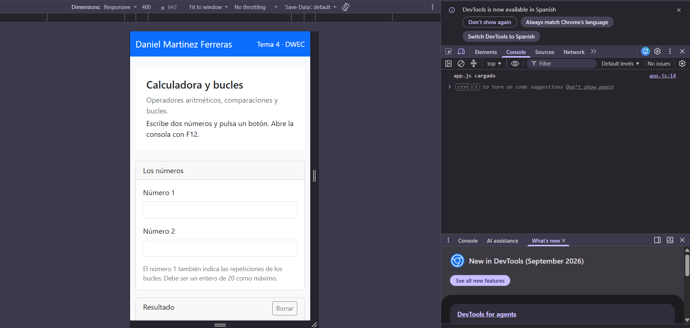
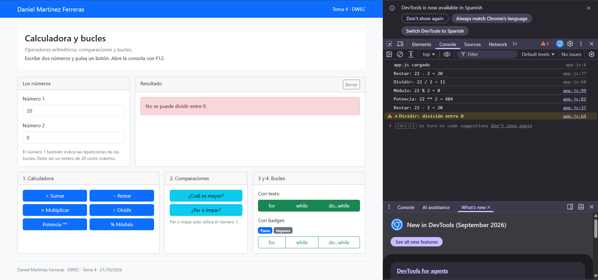
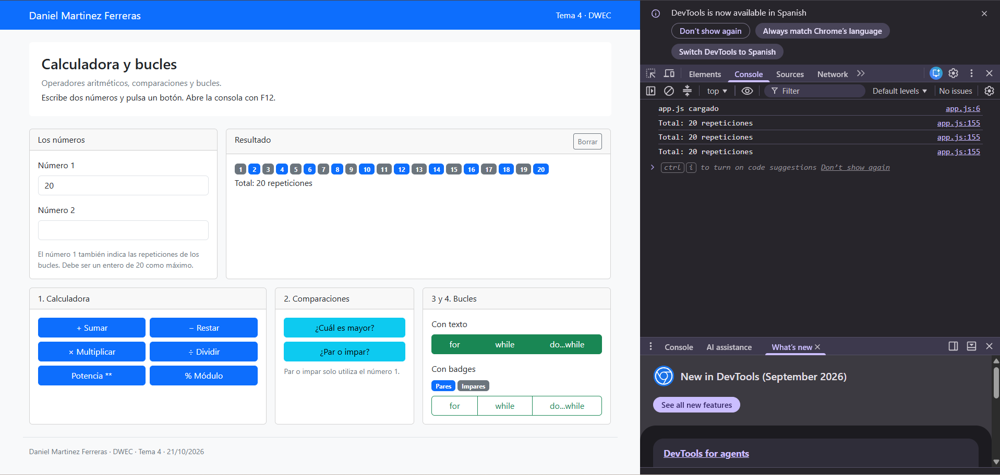

# Tarea 4 · Calculadora y bucles

**Autor:** Daniel Martinez Ferreras · Desarrollo Web en Entorno Cliente (DWEC) · 2.º DAW · Curso 2026-27  
**Fecha:** 21/10/2026

En esta carpeta se encuentra la tarea del tema 4, dedicada a los operadores y los bucles de JavaScript. La página está maquetada con Bootstrap y permite realizar operaciones matemáticas, comparar números y probar los bucles `for`, `while` y `do...while`.

Para utilizarla, abre `index.html` en el navegador, introduce los números y pulsa los botones. Puedes abrir las herramientas de desarrollo con **F12** para consultar los mensajes de la consola.

## Capturas

### a) La página entera

Se muestra la página completa, con mi nombre en la barra de navegación y las tarjetas organizadas mediante la rejilla de Bootstrap.

### b) La página en el móvil

Se muestra la adaptación de la página a una pantalla pequeña, con las tarjetas colocadas una debajo de otra.

### c) El error de dividir entre 0

Se muestra el mensaje de error al intentar dividir entre cero y el aviso correspondiente en la consola.

### d) Los tres bucles con el número 0

Los bucles `for` y `while` no realizan ninguna repetición con cero. El bucle `do...while` se ejecuta una vez porque comprueba la condición después de ejecutar su bloque.

### e) Un bucle con badges

Se muestran los números de las repeticiones mediante badges de Bootstrap. El operador ternario permite elegir un color para los números pares y otro para los impares.

## Reflexión

El bucle `for` es útil cuando sabemos cuántas veces queremos repetir una acción.  
El bucle `while` repite el bloque mientras se cumpla una condición.  
El bucle `do...while` ejecuta primero el bloque y comprueba la condición después.  
Por eso, con el número 0, `for` y `while` no realizan ninguna repetición.  
En cambio, `do...while` ejecuta el bloque una vez, aunque la condición sea falsa después.  
Usaría `for` para contar repeticiones, `while` para condiciones que pueden cambiar y `do...while` cuando necesite ejecutar una acción al menos una vez.

## Fuentes

- [Bootstrap 5.3](https://getbootstrap.com/docs/5.3/)
- [MDN: Operadores de JavaScript](https://developer.mozilla.org/es/docs/Web/JavaScript/Guide/Expressions_and_operators)
- [MDN: Sentencias de iteración](https://developer.mozilla.org/es/docs/Web/JavaScript/Guide/Loops_and_iteration)

## Uso de IA

He utilizado herramientas de inteligencia artificial muy poco, solamente para resolver algunas dudas puntuales y orientarme en algunos momentos de la tarea. Después he revisado el código y comprobado su funcionamiento.