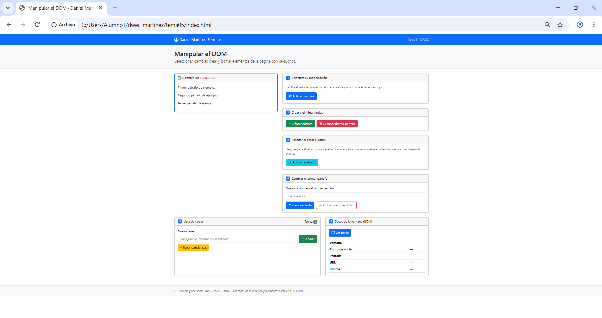
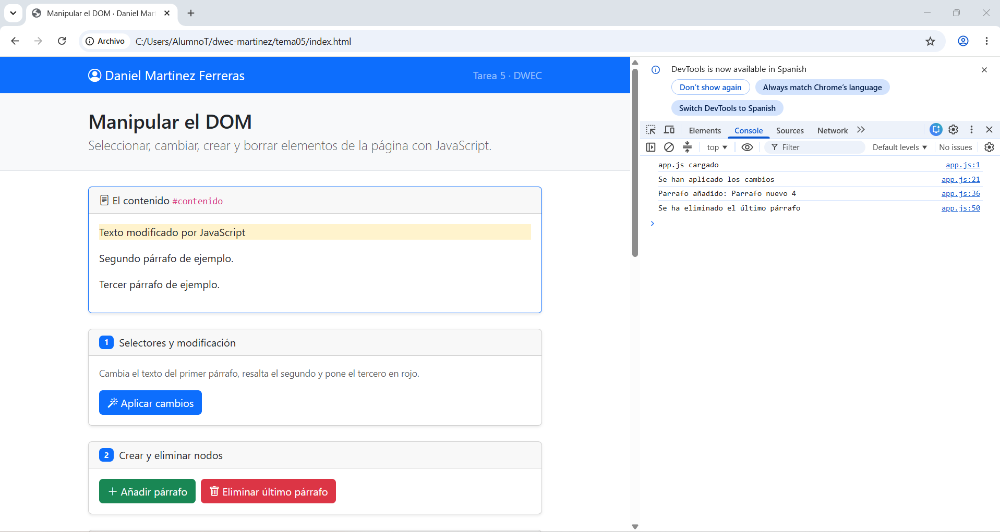
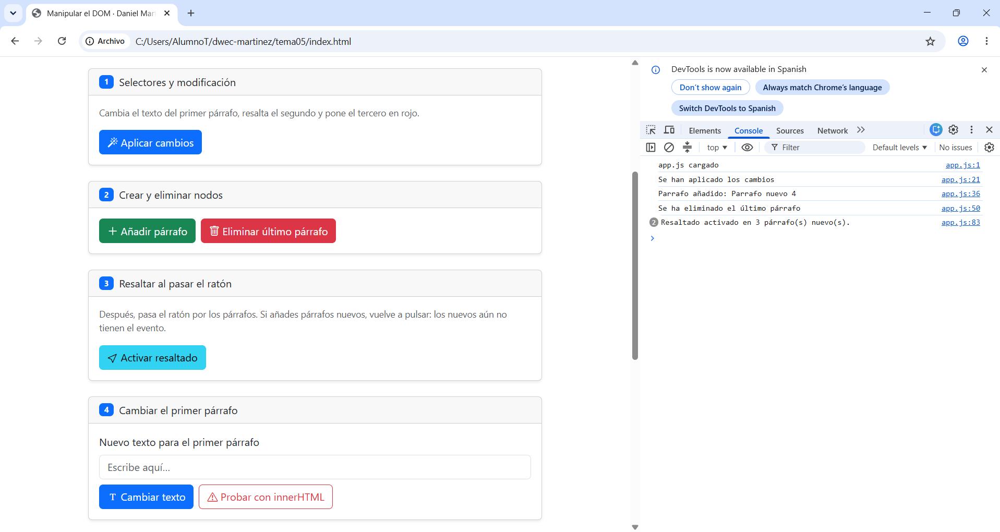
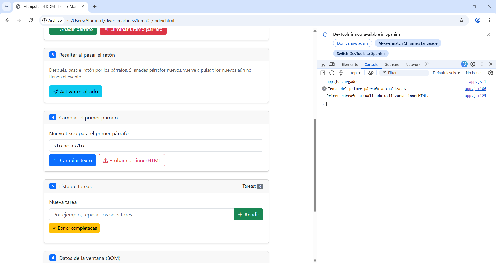
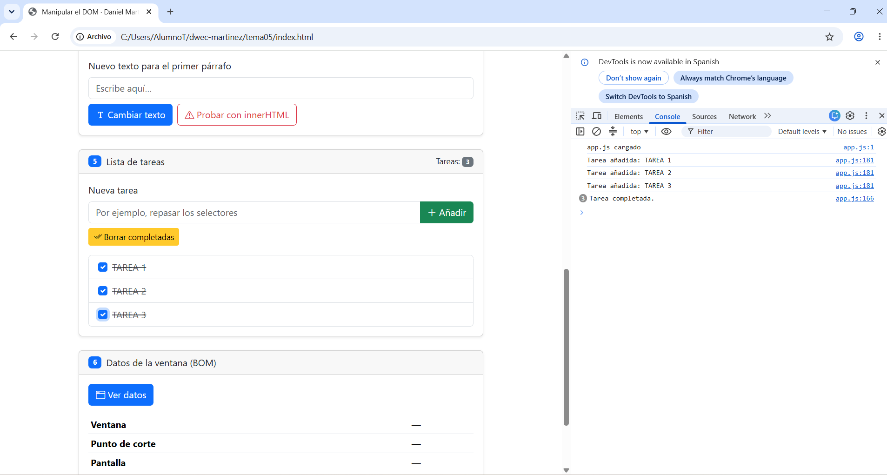
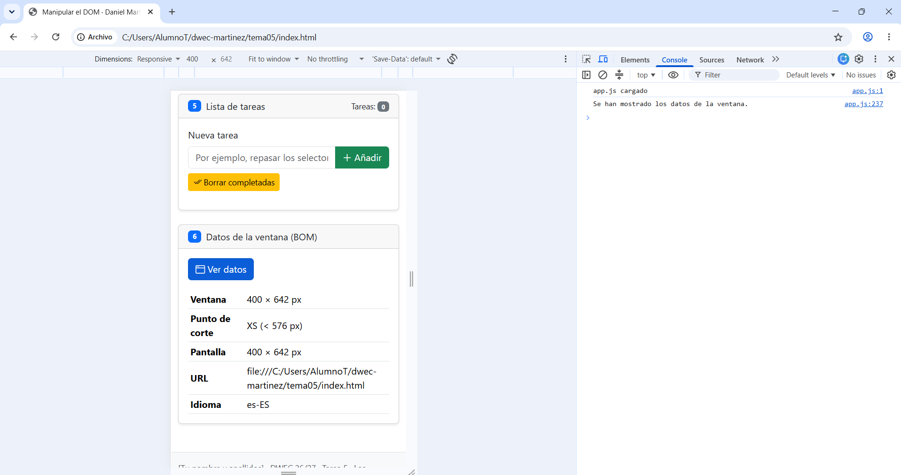

# Tarea 5 · Manipular el DOM

**Autor:** Daniel Martinez Ferreras  
**Módulo:** Desarrollo Web en Entorno Cliente (DWEC)  
**Curso:** 2.º DAW · 2026-2027

## Descripción

En esta tarea he trabajado con JavaScript para manipular el DOM de una página web. He utilizado selectores para acceder a los elementos HTML, he cambiado textos y clases de Bootstrap, he creado y eliminado párrafos y he añadido eventos para resaltar el contenido al pasar el ratón. También he creado una lista de tareas interactiva y he consultado información de la ventana y del navegador mediante el BOM.

Para probar la página, abro `index.html` en el navegador, por ejemplo, mediante Live Server desde Visual Studio Code. La lógica de los botones se encuentra en `js/app.js`.

## Capturas

### a) Página recién cargada

Se muestra la página inicial «Manipular el DOM», con mi nombre en la barra superior y los tres párrafos de ejemplo.

### b) Ejercicios 1 y 2: selectores y creación de párrafos

En el ejercicio 1 he cambiado el texto del primer párrafo, resaltado el segundo con `bg-warning-subtle` y puesto el tercero en rojo con `text-danger`. En el ejercicio 2 he probado a añadir y eliminar párrafos utilizando `createElement()`, `append()` y `remove()`.

### c) Ejercicio 3: resaltado al pasar el ratón

He utilizado los eventos `mouseenter` y `mouseleave` para añadir y quitar la clase `bg-body-secondary` cuando el ratón entra y sale de un párrafo. Los párrafos creados después no tienen estos eventos asignados, por lo que hay que volver a pulsar «Activar resaltado».

### d) Ejercicio 4: diferencia entre `textContent` e `innerHTML`

He probado a escribir `<b>hola</b>` en el campo de texto. Con `textContent`, las etiquetas se muestran como texto; con `innerHTML`, el navegador interpreta las etiquetas y muestra «hola» en negrita.

### e) Ejercicio 5: lista de tareas

He añadido tres tareas y he marcado una como completada. Las tareas se crean mediante elementos HTML y el contador se actualiza al añadirlas o borrarlas. El botón «Borrar completadas» elimina las tareas marcadas.

### f) Ejercicio 6: datos de la ventana en modo móvil

He consultado el tamaño de la ventana, el punto de corte de Bootstrap, el tamaño de la pantalla, la URL y el idioma del navegador. He probado la página en el modo dispositivo de las herramientas de desarrollo del navegador.

## Reflexión

La propiedad `textContent` permite introducir texto sin interpretar las etiquetas HTML. En cambio, `innerHTML` interpreta el contenido como HTML y permite mostrar elementos como el texto en negrita. Por ejemplo, al introducir `<b>hola</b>`, con `textContent` se ven las etiquetas, mientras que con `innerHTML` aparece «hola» en negrita. No es recomendable introducir directamente en `innerHTML` contenido escrito por los usuarios, porque podría contener código HTML malicioso. Para mostrar texto introducido por el usuario de forma segura, es preferible utilizar `textContent`.

## Uso de IA
He usado la IA para entender algunos conceptos de las tareas del app.js y poder correguir algunos errores que he tenido en la actividad 4 y 5.
La IA me ha ayudado ha hacer el README.md. He usado de IA de apoyo (ChatGPT).
