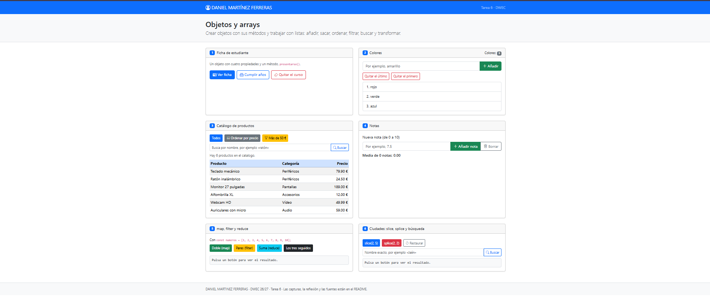
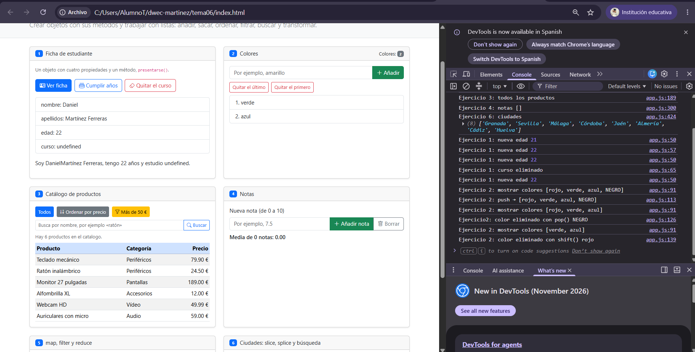
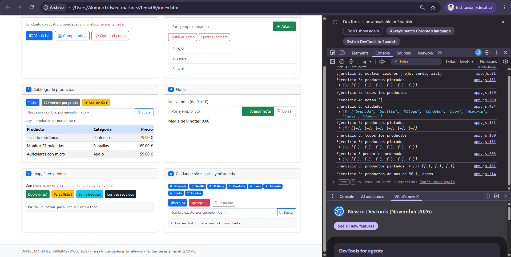
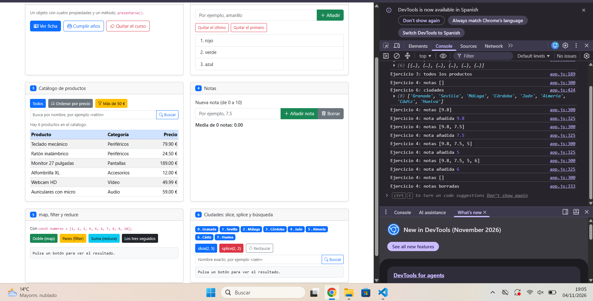
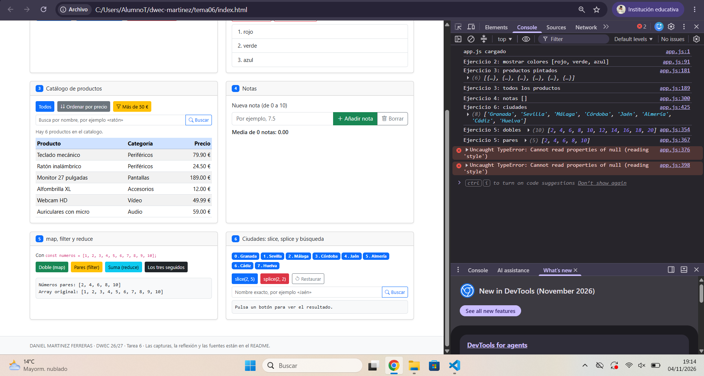
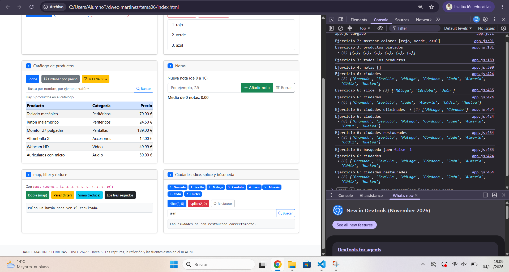

# Tarea 6 · Objetos y arrays

**Autor:** Daniel Martínez Ferreras · Desarrollo Web en Entorno Cliente (DWEC) · 2.º DAW · Curso 2026-27

## Descripción

En esta carpeta está realizada la Tarea 6 sobre objetos y arrays de JavaScript.

Para ver la página hay que abrir el proyecto en Visual Studio Code y utilizar Live Server o Go Live para abrir el archivo `index.html`. La página tiene seis ejercicios con diferentes botones para probar las funciones. También se puede abrir la consola del navegador pulsando F12 para ver los resultados.

## Capturas

### a) La página recién cargada

En esta captura se puede ver la página principal con mi nombre, las seis tarjetas de ejercicios, la lista inicial de colores, el catálogo de productos y las ciudades.

### b) Ejercicios 1 y 2: la ficha y los colores

En el ejercicio 1 he creado un objeto estudiante con cuatro propiedades: nombre, apellidos, edad y curso. También tiene un método llamado `presentarse()`. He añadido botones para mostrar la ficha, cumplir años y quitar el curso.

En el ejercicio 2 he trabajado con una lista de colores. He utilizado `push()` para añadir colores, `pop()` para quitar el último y `shift()` para quitar el primero.

### c) Ejercicio 3: el catálogo ordenado por precio

En este ejercicio he creado un catálogo con seis productos. Cada producto tiene nombre, precio y categoría.

He utilizado `sort()` para ordenar los productos de menor a mayor precio. También he utilizado `filter()` para mostrar los productos de más de 50 € y `find()` para buscar un producto por su nombre.

He utilizado una copia del array para ordenar los productos sin modificar la lista original.

### d) Ejercicio 4: las notas y la media

En este ejercicio he creado un objeto alumno para guardar las notas. Se pueden añadir notas entre 0 y 10 y también borrarlas.

Las notas aprobadas aparecen en verde y las suspensas en rojo. He utilizado `reduce()` para calcular la media de todas las notas.

### e) Ejercicio 5: los tres métodos seguidos

En este ejercicio he trabajado con los números del 1 al 10.

Primero he utilizado `filter()` para seleccionar los números pares. Después he utilizado `map()` para multiplicarlos por dos. Por último, he utilizado `reduce()` para sumar todos los resultados.

El resultado final es **60**.

### f) Ejercicio 6: después de splice y de buscar una ciudad

En este ejercicio he creado una lista con ocho ciudades de Andalucía.

He utilizado `slice(2, 5)` para obtener una parte de la lista sin modificarla. También he utilizado `splice(2, 2)` para eliminar dos ciudades, que son Málaga y Córdoba.

Para buscar una ciudad he utilizado `includes()` y `indexOf()`. Así puedo comprobar si existe y saber en qué posición se encuentra.

## Reflexión

En esta práctica he aprendido a trabajar con objetos y arrays utilizando diferentes métodos de JavaScript.

He aprendido que algunos métodos modifican el array original, como `push()`, `pop()`, `shift()`, `splice()` y `sort()`. Otros métodos, como `map()`, `filter()` y `slice()`, devuelven un resultado nuevo sin modificar el array original.

En el ejercicio 6 he podido comprobar la diferencia entre `slice()` y `splice()`. El primero obtiene una parte de la lista y el segundo elimina elementos.

En el ejercicio 3 he utilizado una copia de los productos para ordenarlos y mantener la lista original.

También he aprendido a buscar elementos, calcular medias y mostrar resultados en la página.

## Fuentes

- Apuntes del Tema 6 de Desarrollo Web en Entorno Cliente.
- MDN Web Docs: JavaScript. https://developer.mozilla.org/es/docs/Web/JavaScript
- W3Schools: JavaScript Array Methods. https://www.w3schools.com/js/js_array_methods.asp

## Uso de IA

He utilizado ChatGPT como ayuda para resolver dudas sobre JavaScript, revisar el código y corregir algunos errores que aparecieron durante la práctica.

Después he revisado los códigos y he probado los botones en el navegador para comprobar que los ejercicios funcionan correctamente.