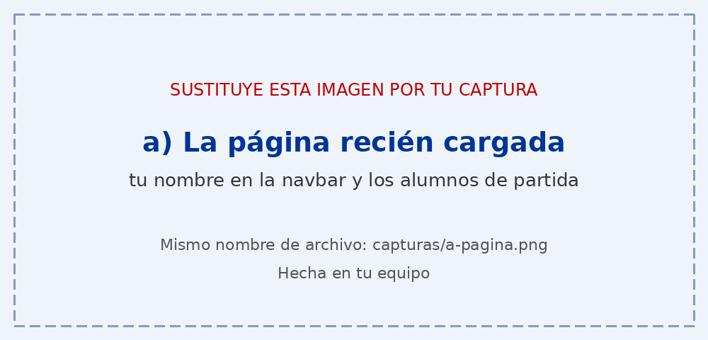
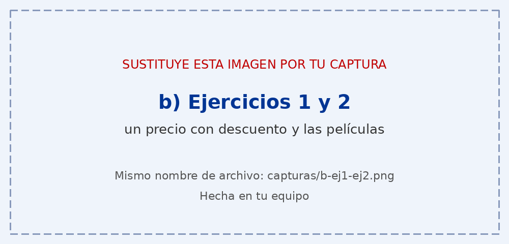
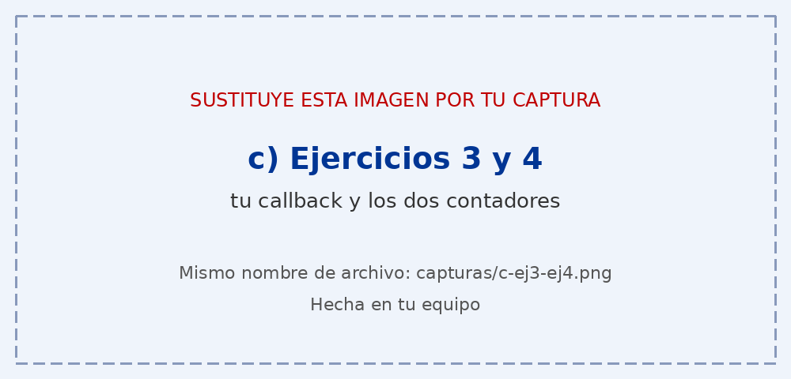
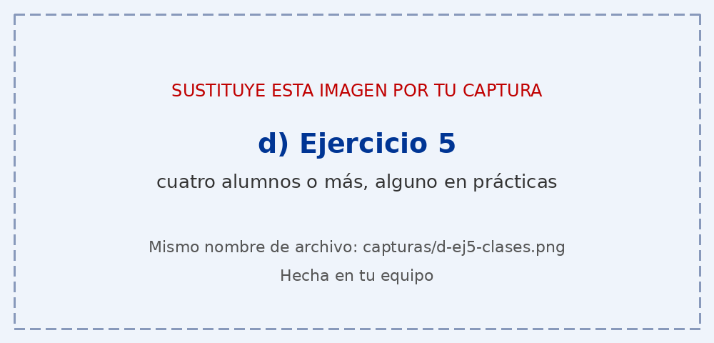

# Tarea 7 · Funciones, flechas y clases

**Autor:** Daniel Martinez Ferreras · Desarrollo Web en Entorno Cliente (DWEC) · 2.º DAW · Curso 2026-27

En esta carpeta se encuentra la resolución de la Tarea 7, en la que se trabajan funciones, funciones flecha, callbacks, closures, clases, herencia y manipulación de arrays y cadenas de texto.

Para probar la página, hay que abrir la carpeta `tema07` en Visual Studio Code, pulsar **Go Live** y probar los diferentes botones con la consola del navegador abierta (F12).

## Capturas

### a) La página recién cargada

Al cargar la página aparece mi nombre en la barra de navegación y se muestran los dos alumnos iniciales, uno de la clase `Alumno` y otro de `AlumnoFCT`.

### b) Ejercicios 1 y 2: el precio y las películas

En el ejercicio 1, la función `calcularPrecio()` calcula el precio final aplicando el descuento y el IVA. La función `mostrarPrecio()` recoge los datos introducidos, comprueba que sean válidos y muestra el desglose del precio.

En el ejercicio 2 se utilizan funciones flecha y métodos de arrays para recorrer, filtrar, ordenar y buscar películas.

### c) Ejercicios 3 y 4: tu callback y los contadores

En el ejercicio 3, la función `transformar()` recibe una lista de números y una operación como callback. Recorre los números con un `for...of`, aplica la operación indicada y devuelve una nueva lista sin modificar la original.

En el ejercicio 4, `crearContador()` utiliza un closure para mantener una cuenta independiente. Así, cada contador conserva su propio valor y puede aumentar de uno en uno o de cinco en cinco.

### d) Ejercicio 5: los alumnos

En este ejercicio se utilizan las clases `Alumno` y `AlumnoFCT`. La segunda hereda de la primera mediante `extends` y utiliza `super()` para llamar al constructor de la clase padre.

Cuando se crea un alumno sin empresa se utiliza la clase `Alumno`. Si se introduce una empresa, se crea un objeto de la clase `AlumnoFCT`. Cada alumno puede tener notas y calcular su media.

### e) Ejercicio 6: fechas y textos

En este ejercicio se calcula cuántos días faltan hasta una fecha determinada y se trabaja con nombres completos para obtener sus iniciales y generar un nombre de usuario con tres cifras aleatorias.

Para calcular los días se utiliza `Math.round()` para redondear el resultado al número de días más cercano, después de ajustar las horas de las fechas a medianoche.

## Reflexión

Con esta tarea he aprendido a utilizar mejor las funciones flecha y los métodos de arrays en JavaScript. He comprendido que las funciones flecha permiten escribir callbacks de una forma más sencilla y que el `return` es necesario cuando queremos devolver un resultado, aunque en las flechas de una sola expresión puede ser implícito. También he aprendido a utilizar closures para crear contadores independientes y clases para organizar mejor el código. Los métodos de las clases se escriben con la sintaxis normal y no con funciones flecha. Uno de los ejercicios que más me ha costado ha sido el de las clases y la herencia, pero me ha servido para entender mejor estos conceptos.

## Uso de IA

Durante la realización de esta tarea he utilizado ChatGPT como herramienta de apoyo para encontrar y solucionar algunos problemas que me aparecían en el código y que no sabía localizar por mi cuenta. También lo he utilizado cuando no encontraba otra solución a determinados errores y necesitaba entender por qué se producían.

He utilizado la inteligencia artificial como apoyo durante el aprendizaje y la resolución de dudas, no para sustituir mi trabajo.