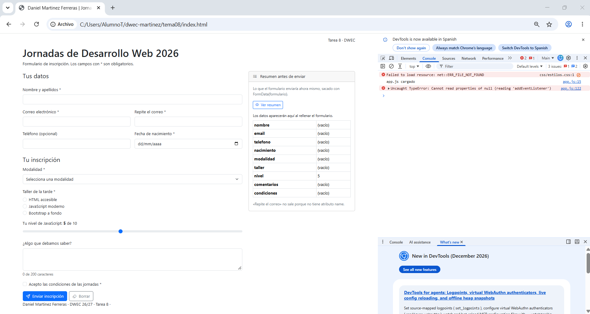
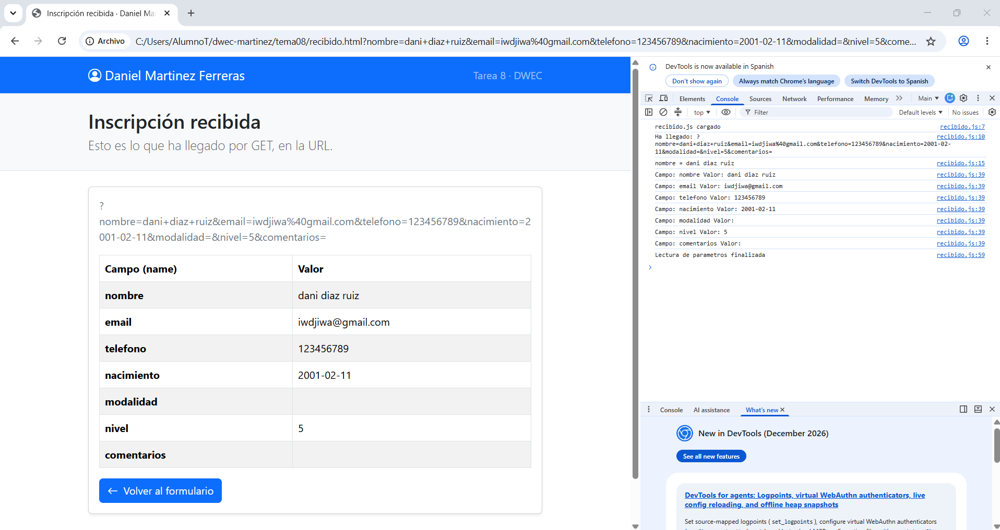
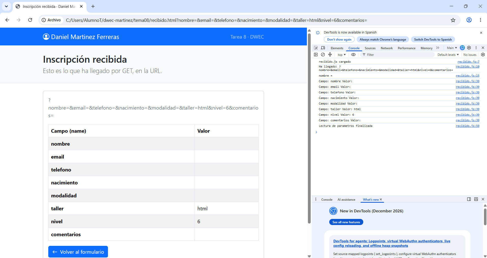
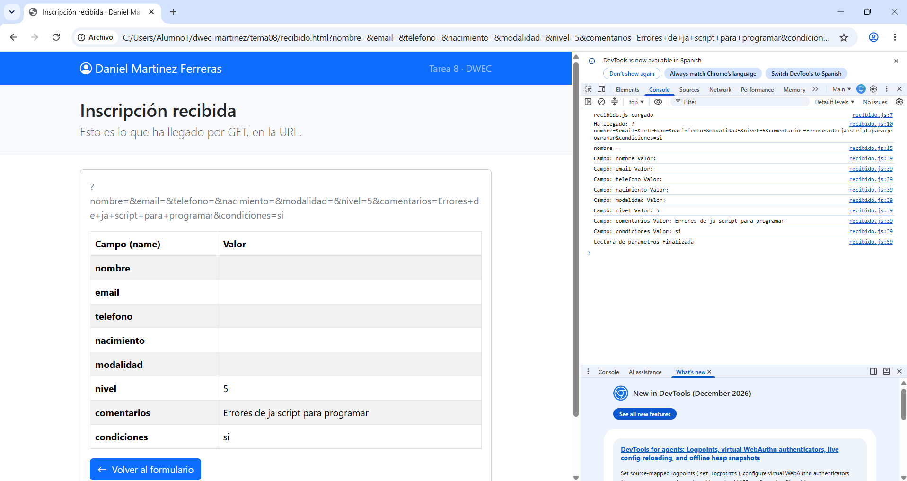
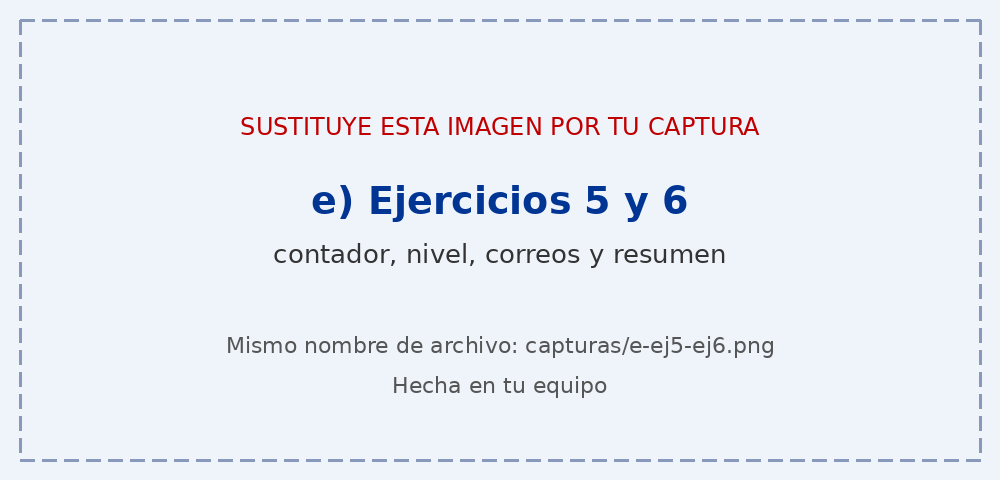

# Tarea 8 · Formulario de inscripción

**Autor:** Daniel Martinez Ferreras · Desarrollo Web en Entorno Cliente (DWEC) · 2.º DAW · Curso 2026-27

## Descripción de la carpeta

En esta carpeta está el formulario de inscripción de la Tarea 8, los archivos JavaScript para validar los datos y mostrar el resumen, y la página `recibido.html`, donde aparecen los datos enviados.

Para probarlo, hay que abrir la carpeta `tema08` en Visual Studio Code, pulsar **Go Live** y completar el formulario con la consola del navegador abierta (F12).

## Capturas

### a) La página recién cargada

En esta captura se muestra el formulario vacío con mi nombre en la barra de navegación. El formulario está dividido en dos fieldset: uno para los datos personales y otro para las preferencias de inscripción.

### b) Ejercicio 2: el mensaje del navegador

En este ejercicio he dejado un campo obligatorio sin rellenar para comprobar la validación del navegador. El navegador muestra un mensaje indicando que hay que completar ese campo.

Si quitamos el atributo `required` desde las herramientas de desarrollador, el navegador permite continuar sin rellenarlo. Esto demuestra que la validación del navegador se puede modificar desde el cliente. Por eso también es necesario validar los datos en el servidor.

### c) Ejercicio 3: lo que llega por GET

Al enviar el formulario mediante GET, los datos aparecen en la barra de direcciones como parámetros de la URL. En `recibido.html`, JavaScript los recoge con `URLSearchParams` y los muestra en una tabla.

El campo de repetición del correo no llega porque no tiene atributo `name`. No se deben enviar contraseñas mediante GET porque quedarían visibles en la URL y podrían guardarse en el historial del navegador.

### d) Ejercicio 4: los errores, junto a cada campo

En este ejercicio he añadido la validación con JavaScript para mostrar los errores debajo de los campos correspondientes.

Algunos ejemplos de errores son:

- Nombre vacío: aparece el mensaje «Escribe tu nombre y apellidos».
- Correo incorrecto: aparece un mensaje indicando que se introduzca un correo válido.
- Fecha fuera del intervalo permitido: se muestra el mensaje indicado en el atributo `title`.
- Condiciones sin aceptar: aparece el mensaje «Debes aceptar las condiciones».

Los mensajes se muestran mediante la función `mostrarError()` y se eliminan con `quitarError()` cuando el campo se corrige.

### e) Ejercicios 5 y 6: eventos y resumen

En el ejercicio 5 he utilizado eventos `input` para actualizar el contador de caracteres de los comentarios y mostrar el valor actual del nivel. También he comprobado que los dos correos coincidan y he añadido la posibilidad de quitar los errores cuando se corrigen los campos.

En el ejercicio 6 he utilizado `FormData` para recoger los datos del formulario y mostrarlos en una tabla al pulsar el botón de resumen. Los campos vacíos aparecen indicados como «(vacío)».

## Reflexión

Con JavaScript puedo personalizar los mensajes de error y comprobar los datos mientras el usuario rellena el formulario. También puedo añadir comprobaciones que el navegador no hace por sí solo, como verificar que los dos correos coinciden. Sin embargo, la validación de JavaScript se ejecuta en el navegador y el usuario puede modificarla o desactivarla. Por eso también hay que validar los datos en el servidor, que es quien debe comprobar que la información recibida es correcta. Cuando el manejador del evento `submit` es una función flecha, `this` no representa el formulario. Para acceder a él puedo utilizar `e.target` o la constante `form`.

## Uso de IA

He utilizado ChatGPT como ayuda para comprender y completar algunas partes de JavaScript de la tarea, comandos que me daban algun error o no entendia.
